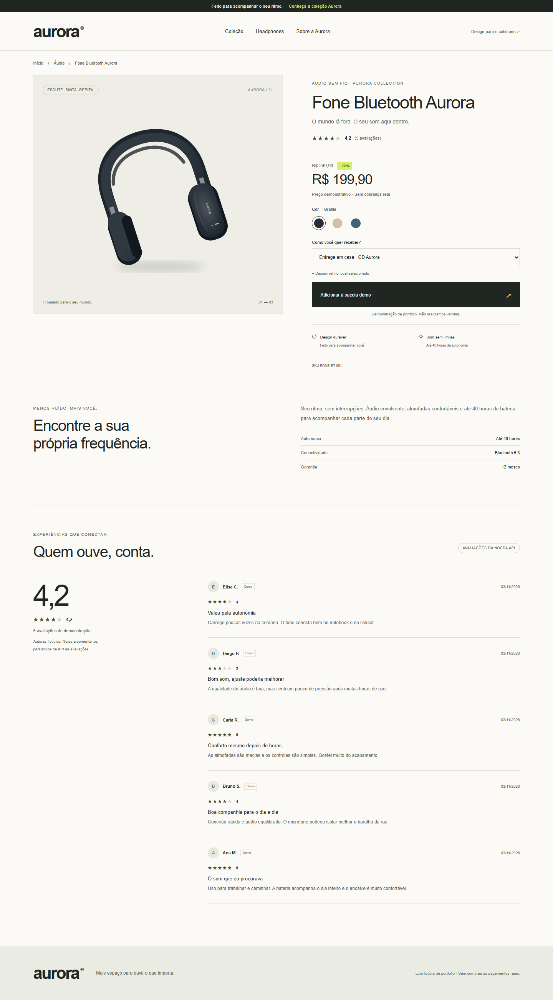
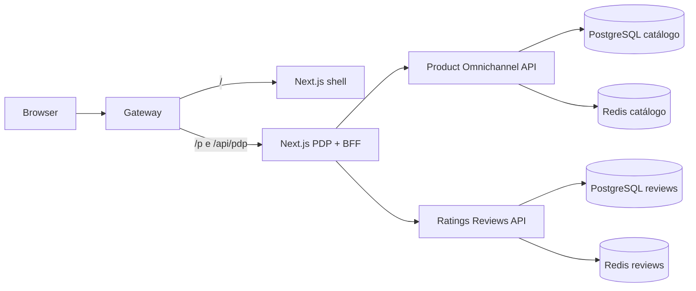

# Aurora · Storefront PDP

Uma página de produto com dados reais de duas APIs autorais: catálogo contextual e avaliações. Inclui um shell e uma PDP com builds/imagens independentes, unidos por rotas no gateway. Interface em português, responsiva e com navegação por teclado. Marca, ilustração SVG e dados são fictícios e autorais.



## O que demonstra

- Next.js App Router, React e TypeScript strict; conteúdo inicial renderizado no servidor.
- MFE por rotas: shell em `/`, PDP em `/p/*`, assets em prefixo próprio; navegação entre zonas recarrega o documento.
- BFF com validação Zod, chamadas concorrentes, timeout e degradação independente de avaliações.
- Catálogo Java/PostgreSQL/Redis com preços por loja e canal, variante esgotada e valores monetários decimais.
- Cinco autores fictícios persistidos na Ratings API: notas 5, 4, 5, 3, 4; média 4,2 no banco isolado inicial.
- Estrelas fracionárias, reviews paginados, JSON-LD de produto e estados vazios/erro reais.
- Docker, testes Playwright com APIs reais, auditoria axe, testes Java com Testcontainers e CI.

## Rodar do zero

Pré-requisitos: Git, Node.js 24 e Docker com Compose v2, engine Linux e aproximadamente 4 GB de memória livre. Java/Maven locais são opcionais; os builds Docker incluem as ferramentas. A primeira execução precisa de internet para imagens e dependências.

```bash
git clone https://github.com/JeffeMartins/storefront-pdp.git
cd storefront-pdp
node scripts/bootstrap.mjs
node scripts/setup.mjs
docker compose up --build -d --wait --wait-timeout 240
node scripts/seed.mjs
```

Os comandos também funcionam em PowerShell. O bootstrap obtém os backends como pastas irmãs em commits registrados em `repositories.lock.json`; checkouts existentes são preservados e sua revisão é informada. Use os commits registrados para reproduzir os resultados. `RATINGS_SOURCE` permite apontar para outro checkout explicitamente.

O setup cria `.env` com senhas aleatórias e não sobrescreve um arquivo existente. Nunca publique esse arquivo. O seed usa autenticação/CSRF por HTTP, é idempotente e não altera comentários preexistentes. `npm ci` não é necessário para iniciar via Docker; é necessário para testes e desenvolvimento no host.

| Recurso            | URL                                                               |
| ------------------ | ----------------------------------------------------------------- |
| Loja / gateway     | http://localhost:3000                                             |
| PDP principal      | http://localhost:3000/p/FONE-BT-001/fone-bluetooth-aurora-grafite |
| Variante azul      | http://localhost:3000/p/FONE-BT-AZUL/fone-bluetooth-aurora-azul   |
| Variante esgotada  | http://localhost:3000/p/FONE-BT-AREIA/fone-bluetooth-aurora-areia |
| PDP standalone     | http://localhost:3002/p/FONE-BT-001/fone-bluetooth-aurora-grafite |
| Swagger catálogo   | http://localhost:8081/swagger-ui/index.html                       |
| Swagger avaliações | http://localhost:8082/swagger-ui/index.html                       |

Todos os binds são localhost. PostgreSQL e Redis não publicam portas no host. O Compose usa volumes `aurora-pdp_catalog-data` e `aurora-pdp_ratings-demo-data`, separados do projeto original de avaliações. Para parar preservando os dados:

```bash
docker compose down
```

Não use `down -v` se quiser preservar os comentários. Para recuperar preço/nota de um SKU:

```bash
curl -sS "http://localhost:3000/api/pdp/FONE-BT-001"
curl -sS "http://localhost:3000/api/pdp/FONE-BT-001?channel=PICKUP&locationId=LOJA-PAULISTA&reviewPage=0&reviewSize=5"
curl -sS "http://localhost:8082/api/v1/products/by-sku/FONE-BT-001?size=5"
```

PowerShell, com saída formatada:

```powershell
curl.exe -sS "http://localhost:3000/api/pdp/FONE-BT-001" | ConvertFrom-Json | ConvertTo-Json -Depth 12
```

## Arquitetura



SSR usa diretamente o serviço do BFF; navegação cliente consulta `/api/pdp/{sku}`. Cada API é dona de seu banco. O BFF não lê tabelas e não conhece credenciais administrativas. A API de catálogo é dona do produto; o cadastro em ratings é uma referência mínima ligada por SKU. O seed é a sincronização da demonstração, sem transações distribuídas.

`apps/shell` e `apps/pdp` têm builds e imagens independentes. O gateway encaminha rotas e assets; não há Module Federation. UI e CSS pequenos estão locais em cada app para permitir deploy independente; não foi criado um pacote compartilhado vazio. O projeto pode extrair componentes para um pacote versionado quando a reutilização justificar.

Preços variam conforme o contexto: grafite WEB/Centro R$ 199,90, Paulista R$ 189,90; azul R$ 219,90. Areia fica esgotado. A interface cancela atualizações anteriores, desabilita compra durante troca de contexto e só aplica a última resposta.

## Desenvolvimento e testes

```bash
npm ci
npm run build
npm run typecheck
npx playwright install chromium
npm run test:e2e
```

O E2E espera o Compose já iniciado e populado. Em Linux limpo, instale o navegador com `npx playwright install --with-deps chromium`. O relatório fica em `playwright-report/`, traces em `test-results/` e screenshots em `.artifacts/`, todos ignorados pelo Git.

Para recarga de frontend no host: mantenha as APIs no Docker e execute `npm run dev --workspace=@aurora/pdp`. A PDP usa catálogo em 8081 e reviews em 8082 por padrão. URLs internas são variáveis de servidor `CATALOG_URL` e `RATINGS_URL`, nunca `NEXT_PUBLIC_*`. Abra a rota completa em http://localhost:3002. O modo integrado no gateway usa os builds de produção.

Detalhes de verificação, cache, falhas e limites estão em [docs/operations.md](docs/operations.md) e [docs/validation.md](docs/validation.md).

## Limites intencionais

A sacola é apenas feedback local; não existe checkout, pagamento, reserva de estoque ou confirmação de pedido. O estoque é informativo e pode estar atrasado pelo TTL. Não há integrações corporativas, endpoints ou assets de empresas. Não existem PLP completa, filtros de reviews por nota, cadastro de clientes ou administração de catálogo.

IA não é chamada pela PDP: a API existente só gera análise em operação administrativa explícita. Exibição pública exige persistência/versionamento e endpoint de leitura. Assim não há custo de IA por visita nem chave no frontend.

A política CSP permite scripts/styles inline necessários a esta implementação SSR; não oferece proteção baseada em nonce. Antes de um deploy externo, revisar CSP com nonce, TLS, autenticação administrativa, quotas e segredos. `robots` da PDP evita indexar produtos fictícios. Os dois backends funcionam localmente, sem depender de parceiros pagos.

Licença MIT para código e ilustrações autorais. [Catálogo](https://github.com/JeffeMartins/product-omnichannel-api) · [Avaliações](https://github.com/JeffeMartins/ratings-reviews-api).
